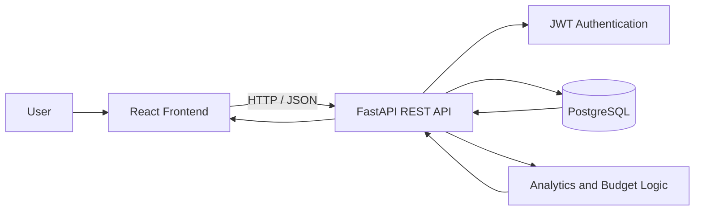

# KharchaKlick

### Personal Finance & Expense Intelligence

KharchaKlick is a full-stack personal finance application that helps users track transactions, stay within budgets, and understand their spending patterns. It combines secure, user-scoped financial records with analytics and rule-based insights that highlight budget overruns, category concentration, and unusual transactions.

**Built with:** React · FastAPI · PostgreSQL · SQLAlchemy · JWT

---

## Why KharchaKlick?

Recording expenses is only the first step. KharchaKlick brings transactions, budgets, and spending insights together so users can move from simply tracking money to understanding their financial habits.

## Key Features

| Area | What it does |
|---|---|
| **Transaction management** | Create, update, delete, search, filter, sort, and paginate income and expense records. |
| **Financial dashboard** | Summarize income, expenses, net balance, category-wise spending, and monthly trends. |
| **Budget tracking** | Set monthly or category budgets and monitor actual spending, remaining balance, and utilization. |
| **Spending insights** | Surface budget overruns, high category concentration, and unusual transactions using category-level spending patterns. |
| **Authentication** | Support registration and login with bcrypt password hashing and JWT-protected API requests. |
| **Data isolation** | Scope financial records to the authenticated user. |

## Unusual Transaction Detection

KharchaKlick includes rule-based checks to help bring noteworthy spending activity to the user's attention:

- **Budget overrun:** Detects when spending exceeds a configured budget.
- **Category concentration:** Highlights when a large share of total spending is concentrated in one category.
- **Unusual transaction:** Compares a transaction with the spending pattern of its category and flags outliers when sufficient transaction history is available.

These checks are designed to make spending patterns easier to review; they are not presented as fraud detection or financial advice.

## Application Architecture



The frontend communicates with the backend through REST endpoints. FastAPI handles request validation, authentication, and application logic, while SQLAlchemy manages PostgreSQL persistence.

## Technology Stack

| Layer | Tools |
|---|---|
| Frontend | React 19, Vite, React Router, Axios |
| Styling & UI | Tailwind CSS 4, Lucide React |
| Backend | Python, FastAPI, Pydantic |
| Database | PostgreSQL, SQLAlchemy 2.0 |
| Security | JWT, bcrypt |
| Testing | Pytest, HTTPX TestClient |
| Charts | Recharts |

## Project Structure

```text
KharchaKlick/
├── backend/
│   ├── app/
│   │   ├── api/routes/       # Auth, transactions, budgets, analytics
│   │   ├── core/             # Database, configuration, security
│   │   ├── models/           # SQLAlchemy models
│   │   ├── schemas/          # Pydantic schemas
│   │   └── main.py
│   ├── tests/
│   ├── .env.example
│   └── requirements.txt
├── frontend/
│   ├── src/
│   │   ├── components/
│   │   ├── context/
│   │   ├── pages/
│   │   ├── services/
│   │   ├── App.jsx
│   │   └── main.jsx
│   └── package.json
└── README.md
```

## Run Locally

### Prerequisites
- Python 3.10+
- Node.js and npm
- PostgreSQL

### 1. Clone the repository

```bash
git clone https://github.com/chowgulesonakshi-lab/KharchaKlick.git
cd KharchaKlick
```

### 2. Configure and start the backend

```bash
cd backend
python -m venv venv
```

Activate the environment:

```bash
# Windows PowerShell
.\venv\Scripts\Activate.ps1

# macOS / Linux
source venv/bin/activate
```

Install dependencies and create your environment file:

```bash
pip install -r requirements.txt
cp .env.example .env
```

Set your PostgreSQL credentials and JWT configuration in `.env`:

```env
DB_USER=postgres
DB_PASSWORD=your_postgres_password
DB_HOST=localhost
DB_PORT=5432
DB_NAME=kharchaklick

JWT_SECRET_KEY=your_secure_secret_key_at_least_32_characters
JWT_ALGORITHM=HS256
ACCESS_TOKEN_EXPIRE_MINUTES=60
```

Start the API:

```bash
uvicorn app.main:app --reload --port 8000
```

Interactive API documentation: **http://localhost:8000/docs**

### 3. Start the frontend

Open another terminal from the repository root:

```bash
cd frontend
npm install
npm run dev
```

Open the local URL printed by Vite (usually **http://localhost:5173**).

### 4. Run backend tests

From the repository root:

```bash
python -m pytest backend/tests -v
```

## Engineering Highlights

- REST API design with request and response validation.
- JWT-based authentication and user-level data access control.
- Relational data modelling with PostgreSQL and SQLAlchemy.
- Filtering, sorting, and database-level pagination for transaction records.
- Aggregation-based financial analytics and budget utilization calculations.
- Automated backend tests using Pytest and HTTPX.

## Roadmap

- AI-assisted explanations for changes in spending patterns.
- Personalized suggestions based on transaction history.
- Natural-language queries such as: *"How much did I spend on food over the last three months?"*

---

**Repository:** [chowgulesonakshi-lab/KharchaKlick](https://github.com/chowgulesonakshi-lab/KharchaKlick)
